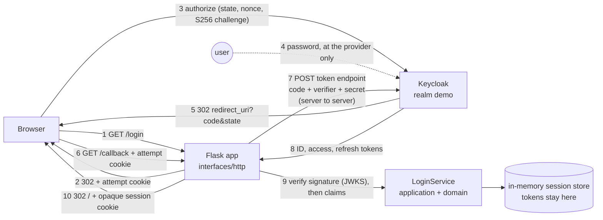

# Architecture

Sign-in for a small server-side app with an identity provider the project runs itself (Keycloak in a container). The app is a *confidential client*: it holds a client secret, registers exactly one redirect URI, and does the authorization code flow with PKCE. The browser carries a code and an opaque cookie; every token stays on the server. Each check in the flow has a test that shows what is refused when the check fires, so the baseline is understood, not copied.

## Pattern: ports and adapters, with the flow in the application layer

The system has three boundaries (the browser, the provider's HTTP API, the provider's signing keys), so the code is layered as ports and adapters:

| Layer | Folder | Owns | May import |
| --- | --- | --- | --- |
| Domain | `src/oidc_login/domain/` | PKCE (`challenge_for`), the ID token claim checks (`check_id_token_claims`, `check_access_token_hash`), scope rules, value objects (`PendingLogin`, `TokenSet`, `UserSession`), named errors with the reasons the lesson asks for | the standard library only |
| Application | `src/oidc_login/application/` | `LoginService` (start, complete, resolve, refresh, sign out) and the ports it needs: `IdentityProvider`, `TokenVerifier`, `PendingLoginStore`, `SessionStore`, `Clock`, `TokenGenerator` | domain |
| Infrastructure | `src/oidc_login/infrastructure/` | `OidcProvider` (httpx), `JwksTokenVerifier` (PyJWT), in-memory stores, settings, JSON logging, the clock | application, domain |
| Interfaces | `src/oidc_login/interfaces/` | the Flask app, cookies and headers, the composition root, WSGI and gunicorn wiring, the scripted browser and the demo | everything below |

Nothing imports `interfaces`. `make lint` enforces the direction with import-linter, and a second contract keeps Flask, werkzeug, httpx and the JWT library out of `domain` and `application`. That is what lets the whole flow, including refusal of forged tokens, run in unit tests against a fake provider that enforces PKCE, single-use codes and refresh rotation, and then run again against the real provider in the integration tests.

## Components

Drawn versions of this figure and of the walk-through: [the architecture](docs/diagrams/architecture.svg) and [one run](docs/diagrams/flow.svg).

## One sign-in, step by step

1. **`GET /login`.** `LoginService.start` draws a PKCE verifier (64 random bytes), a `state`, a `nonce` and an attempt id, and stores them as a `PendingLogin`. Only the S256 challenge goes to the provider. The browser gets a redirect to the authorization endpoint and a `__Host-login` cookie holding the attempt id (`HttpOnly`, `Secure`, `SameSite=Lax`, ten minutes).
2. **At the provider.** The user authenticates at the provider; the app never sees the password. The provider checks that `redirect_uri` is *exactly* the registered one, then redirects the browser back with a one-time `code` and the same `state`.
3. **`GET /callback`.** `complete` pops the pending login by the attempt id from the cookie (single use), compares `state` in constant time and checks the attempt's age. Missing cookie, unknown or used attempt, wrong state, expired attempt: `StateMismatchError`, a 400, and no call to the provider.
4. **Token exchange.** The server POSTs the code, the verifier, the client id and the secret to the token endpoint. The code is good once and only with the verifier that matches the challenge.
5. **Signature, then claims.** `JwksTokenVerifier` accepts only the algorithms on its list (RS256), picks the key by `kid` from the provider's JWKS (refetching at most once every 30 seconds for an unknown `kid`) and verifies the signature. Only then `check_id_token_claims` checks issuer, audience (and `azp` when there are several), expiry, issued-at, `nonce` and `sub`, and `check_access_token_hash` checks `at_hash`. Each failure raises its own named error.
6. **Session.** A new random 256-bit session id becomes the `__Host-session` cookie (`HttpOnly`, `Secure`, `SameSite=Lax`); the server keeps the SHA-256 of it with the identity, the tokens and a CSRF token. The browser is redirected to `/`.
7. **Later requests.** `resolve` enforces an idle limit (15 minutes) and an absolute limit (8 hours). `GET /api/profile` asks for an access token; if it expires within 30 seconds, `refresh` trades the refresh token for new tokens. The provider rotates the refresh token, the service stores the new one and the old one is dead.
8. **Sign-out.** `POST /logout` (CSRF token required) deletes the session, then revokes the refresh token at the provider (RFC 7009). A failed revocation is logged and does not keep the local session alive.

## Decisions and their trade-offs

- **The login attempt is bound to the browser** ([ADR 1](docs/adr/0001-bind-the-callback-to-the-browser.md)). The lesson's sample looks the pending login up by `state` alone, which lets an attacker start a login in their own browser and have the victim's browser complete it (login CSRF). Here the attempt id travels in a cookie too, and the callback needs both.
- **Allow-listed algorithm, key by `kid`** ([ADR 2](docs/adr/0002-verify-signatures-against-an-allow-list.md)). `none` and the HMAC family are refused by name before any key is touched, which closes algorithm confusion. The test builds the confusion token by hand because the library refuses to.
- **Tokens only on the server, in memory** ([ADR 3](docs/adr/0003-tokens-stay-on-the-server.md)). The browser holds two opaque cookies. The price: the stores belong to one process, so the app runs one worker with several threads, and a restart signs everyone out.
- **Client secret in the request body** (`client_secret_post`), not HTTP Basic. Both are standard; the body avoids the form-encoding rule for Basic credentials. It never appears in a URL, a log line or a page.
- **No retries on back-channel POSTs.** A second exchange of the same code fails by design, so retrying would only hide the first error. Idempotent GETs (discovery, keys) retry with backoff.
- **Discovery is validated.** The `issuer` in the document must equal `OIDC_ISSUER`, and every endpoint the app uses must be present; a document that disagrees makes `/readyz` fail instead of silently trusting another issuer.
- **The first state is a strict one.** `Settings` refuses an `http` redirect URI that is not on localhost, an `http` issuer or `COOKIE_SECURE=false` when `APP_ENV=production`.
- **Logout does not end the provider's own browser session.** The app's session and the refresh token are gone; the user's next `/login` may sign in without a password prompt while the provider session lasts. RP-initiated logout (`end_session_endpoint` with an ID token hint) would also end that session and is listed under extensions.

## Failure modes the lesson teaches, and where the code shows them

| Failure | Where the code refuses it | Test that shows it |
| --- | --- | --- |
| Wrong or reused `state`; callback from another browser; replayed callback | `LoginService._claim_attempt` | `test_flow_protections.py::test_a_callback_with_a_mismatched_state_is_refused`, `..._browser_that_did_not_start_the_login...`, `..._cannot_be_replayed` |
| Lookalike redirect URI | The provider's exact-match registration | `test_the_provider_refuses_lookalike_redirect_uris_before_the_app_sees_anything` |
| Authorization code reused or stolen | The provider (single use, PKCE) | `test_a_code_can_be_exchanged_only_once`, `test_a_code_is_useless_without_the_pkce_verifier` |
| Token for another audience, expired token, forged signature, `alg: none`, algorithm confusion, wrong nonce | `JwksTokenVerifier` and `check_id_token_claims` | `test_token_validation.py`, `unit/test_claims.py`, `unit/test_jwks_verifier.py` |
| A token leaking through the browser | The session design | `test_a_full_sign_in_works_and_the_browser_receives_only_an_opaque_cookie`, `unit/test_http_app.py::test_no_token_ever_reaches_the_browser` |
| Stolen refresh token used after rotation or sign-out | The provider (rotation, revocation) | `test_a_refresh_issues_a_new_refresh_token_and_the_old_one_is_refused...`, `test_after_sign_out_the_old_session_and_the_old_refresh_token_are_both_refused` |
| Public client without PKCE | The provider's client setting `pkce.code.challenge.method=S256` | `test_a_public_client_cannot_exchange_a_code_without_the_pkce_verifier` |
| Route needing more than the user asked for | `scopes.require` | `test_a_route_needing_the_reports_scope_refuses_a_sign_in_that_did_not_ask_for_it` |

## Limits of the teaching build against a production one

- **Keycloak in development mode** (`start-dev`, an embedded database, HTTP). A production provider runs `start` with PostgreSQL, TLS and a real hostname. The realm file shows the client, scope and token-lifetime settings that matter; the rest is the provider's operations.
- **One process.** Sessions and pending logins are in memory (see ADR 3). A Redis adapter for `SessionStore` and `PendingLoginStore` is the way to run several replicas; the refresh lock then becomes a per-session lock in the shared store.
- **TLS is somebody else's job.** The cookies are `Secure` and HSTS is sent; `http://localhost` is the one place a browser lets that work without TLS.
- **No sender-constrained tokens** (DPoP or mutual TLS): a stolen access token is usable until it expires in two minutes. The stretch goal is described, not built.
- **No RP-initiated logout and no back-channel logout** from the provider.
- **Demo identities** come from the realm import; the passwords are throwaway values from `.env`.

## How to extend it

- **A shared session store:** implement `SessionStore` and `PendingLoginStore` over Redis (`SET ... EX`, and `GETDEL` for the single-use pop), then raise `workers` in `gunicorn_conf.py`.
- **Another provider:** change `OIDC_ISSUER`, the client id and secret, and the redirect URI. Nothing else is Keycloak-specific except the realm file; the scripted browser's form parser is only for tests.
- **A role or scope check on another route:** call `scopes.require(session.scopes, "name")`; the error handler already answers 403.
- **Sender-constrained tokens:** add a DPoP proof to `OidcProvider._post` and to the userinfo call, and store the key pair in the session.
- **RP-initiated logout:** redirect to `end_session_endpoint` with `id_token_hint` and a registered `post_logout_redirect_uri` after `sign_out`.
