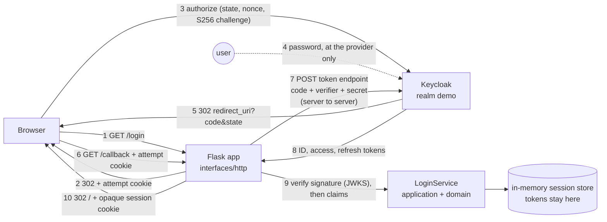

# Markdown and Mermaid (the documents)

## What it is

**Markdown** is a way of writing formatted documents in plain text. You mark headings with `#`, lists with `-`, emphasis with asterisks, code with backticks, and tables with `|`. A program (GitHub's page, an editor preview) turns the plain text into a formatted page. The files end in `.md`. **Mermaid** is a small language for drawing diagrams from text. A **fenced block** (a block of lines between two lines of three backtick characters) whose opening fence is followed by the word `mermaid` is drawn as a diagram by GitHub and by many editors. The text stays readable in a plain editor and is easy to review in a change.

## Why this repository uses it

The lesson asks for documents as well as code: a README that proves each requirement, an architecture document with a diagram of the sign-in, short records of decisions (**ADRs**, architecture decision records) and a changelog. Plain text files that live next to the code change with the code and are reviewed with the code. The README's `make demo` output is pasted from a real run, so a reader can compare it with their own.

## Where it appears

| Path | What it is |
| --- | --- |
| `README.md` (175 lines) | The entry point: setup, run, test, stop; the identity provider's configuration; for each "done when" line of the lesson the proof (the 16-step scenario as `make demo` prints it); the attacks the protections prevent; stretch goals; what is simplified. |
| `ARCHITECTURE.md` (85 lines) | The layers, a Mermaid diagram of one sign-in, the sign-in step by step, decisions, failure modes, limits, how to extend. |
| `CHANGELOG.md` (15 lines) | What changed in each version, in the Keep a Changelog format. |
| `docs/adr/0001` to `0003` | Three decision records: bind the callback to the browser that started the login, verify signatures against an allow-list, tokens stay on the server. |
| `tech/*.md` | These notes. |

## How it works underneath

1. A Markdown file is ordinary text. A **renderer** reads it line by line and builds the formatted page.
2. The syntax used in this repository:
   - `# Title`, `## Section`, `### Subsection`: headings, by number of `#`.
   - A blank line separates paragraphs. Two spaces at the end of a line force a line break.
   - `- item` or `1. item`: bullet and numbered lists.
   - `**bold**`, `*italic*` (or `_italic_`), and text in backticks for inline code.
   - Three backticks on a line of their own open and close a block of code; the word after the opening fence (`python`, `bash`, `mermaid`) names the language so the renderer can color it.
   - `[text](address)`: a link. `[text](docs/adr/0001-server-side-sessions.md)` is a relative link to another file in the repository.
   - A table is rows of cells between `|` characters, with a second line of `---` under the header row.
   - `> text` is a quotation.
3. Mermaid is drawn in the browser from the text between the fences; it does not change the Markdown file.

## Walkthrough of this repository's use

### The README

The header table gives the lesson address, planned hours, level and links. The sections are: Prerequisites; "Setup, run, test, stop" (the exact commands); "The identity provider's configuration" (the realm, the two clients, the scopes); "Done when: the lesson's checklist and the proof for each line" with "The scenario, as `make demo` runs it" (every step and its real evidence line); "The attacks the protections prevent"; "Stretch goals"; "What is simplified for teaching"; "Project structure" (a text tree of the folders); and "Author and license".

### The architecture document and its diagram



- `flowchart LR` starts a flow diagram laid out left to right.
- `browser["Browser"] -- "1 GET /login" --> app` defines a **node** called `browser` with the label "Browser", and an arrow to the node `app` with the text "1 GET /login" on it. The word before the brackets is the node's id; the quoted text is its label; `<br/>` inside a label is a line break.
- `user(("user"))` draws a circle; `store[("...")]` draws a cylinder (a store of data). `a -. "text" .-> b` is a dotted arrow, used for the step where the user types a password at the provider: it is not a program-to-program call.
- The numbers in the arrow labels are the order of the steps. Read them in turn: (1) the browser asks the app for `/login`; (2) the app answers with a redirect and a cookie that ties the attempt to this browser; (3) the browser goes to Keycloak with `state`, `nonce` and the PKCE challenge; (4) the user types the password at Keycloak only; (5) Keycloak redirects the browser back to the registered address with a one-time code; (6) the browser calls the app's `/callback`; (7) the app, server to server, trades the code plus the PKCE verifier plus its own secret for tokens; (8) Keycloak returns the ID, access and refresh tokens to the app; (9) the app verifies the signature against Keycloak's published keys and then the claims in `LoginService`; the tokens go into the in-memory session store and stay there; (10) the app redirects the browser home with one opaque session cookie.

### An ADR

Each decision record has the same sections: a numbered title (`# 1. Bind the callback to the browser that started the login`), a date and status line, **Context** (the problem), **Decision** (what was chosen), **Alternatives** (what was not, and why), **Consequences** (what the choice costs and gains). A reader a year later can see why the code is the way it is. ADR 1 explains the `__Host-login` cookie that ties a callback to the browser that started it; ADR 2 the algorithm allow-list that closes the "algorithm confusion" attack; ADR 3 why tokens never leave the server.

### The changelog

Follows Keep a Changelog: a heading per version with a date (`## [0.1.0] - 2026-10-27`), then `### Added` with bullets. The project uses Semantic Versioning: `MAJOR.MINOR.PATCH`.

## Try it yourself

1. Read the diagram's source and preview it: open `ARCHITECTURE.md` in GitHub or an editor with Markdown preview. The Mermaid block renders as a boxes-and-arrows picture.
2. List the ADRs:
   ```bash
   ls docs/adr
   ```
   Expect three files numbered `0001` to `0003`.
3. Check that the README's scenario matches the program's: run `make demo` (needs Keycloak) and compare the 16 numbered lines with the section "The scenario, as `make demo` runs it".
4. Check every relative link in the README points at a file that exists:
   ```bash
   grep -o "](\([^)#]*\))" README.md | grep -v "http" | sed 's/](//; s/)//' | while read f; do [ -e "$f" ] || echo "missing $f"; done
   ```
   Expect no output.

## Mistakes people make

- Documents that drift from the code. Here the README's outputs were pasted from real runs and the scenario program prints the same lines.
- Links with absolute paths that only work on one machine. Relative links work for everyone.
- Pictures of diagrams that cannot be edited. Mermaid is text and shows up in diffs.
- Forgetting the blank line before a table or list, which makes the renderer treat it as part of the paragraph above.
- Putting secrets or real credentials in a document. None appear in these.

## Check yourself

1. How do you write a level-two heading?
   *`## Heading`.*
2. What does the word after the opening code fence do?
   *Names the language so the renderer can color it (`bash`, `mermaid`).*
3. What does `a & b --> c` mean in Mermaid?
   *Arrows from both a and b to c.*
4. What are the four sections of an ADR here?
   *Context, Decision, Alternatives, Consequences.*
5. What does a dotted arrow mean in the diagram?
   *A step that is not a program-to-program call: the user typing a password at the provider.*

## Further reading

- Markdown guide (CommonMark): https://commonmark.org/help/
- GitHub-flavored Markdown (tables, task lists): https://github.github.com/gfm/
- Mermaid flowcharts: https://mermaid.js.org/syntax/flowchart.html
- Architecture decision records: https://adr.github.io/
- Keep a Changelog: https://keepachangelog.com/en/1.1.0/
- Semantic Versioning: https://semver.org/
